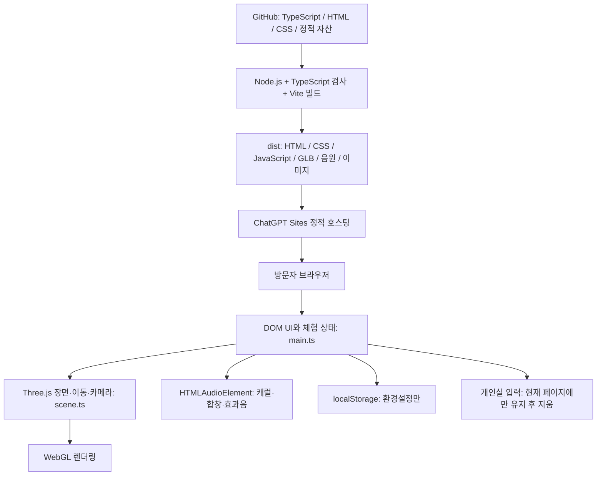

# In a Peace · 아키텍처와 개발 언어

작성일: 2026-11-05 (한국 시간). 구현 기준: M16, 커밋 `676cc745e2be84f4a3831cee4982d6b8f0f12c41`.
이 문서는 실제 소스와 잠금 파일을 확인해 작성했다. M17은 문서화와 공개 테스트 종료 작업이며 앱 기능을 추가하지 않는다. 스탠드얼론 전환은 사용자 요청으로 취소했다.

## 1. 전체 구조

브라우저에서 3D 성당과 상호작용을 실행하는 **정적 웹 앱**이다. TypeScript로 작성한 코드를 JavaScript로 빌드하고 HTML·CSS·3D 모델·음원을 정적 호스팅으로 전달한다. 별도 서비스 API, 앱 전용 서버 프로세스, 서버 DB, 사용자 계정 시스템은 구현하지 않았다.



이 다이어그램은 논리적 처리 흐름이다. GitHub 커밋만으로 자동 배포되는 CI 파이프라인을 뜻하지 않는다. 배포는 Sites 소스 저장·버전 저장·배포 절차로 수행했다. 서버 하드웨어와 호스팅 내부 구성은 이 저장소에서 직접 관리하지 않는다.

## 2. 개발 언어와 실행 환경

- **TypeScript:** 앱 로직, 3D 장면, 캐릭터·방문자 움직임, 기도·지휘 상태, 설정 처리. `src/*.ts`.
- **HTML:** 첫 화면, 하단 메뉴, 개인실 입력, 성당 목록 등 UI 골격. [index.html](../index.html).
- **CSS:** 반응형 배치, 메뉴·대화상자·안내·효과 화면. [src/style.css](../src/style.css).
- **JavaScript ES modules (`.mjs`):** 개발 단계의 GLB 생성과 자동 검사. [scripts/scenes.mjs](../scripts/scenes.mjs), [scripts/collection.mjs](../scripts/collection.mjs), `tests/*.test.mjs`.
- **Python:** 합성 합창과 행동 효과음 제작 보조 도구. [scripts/choir-audio.py](../scripts/choir-audio.py). 웹 앱 실행에는 Python이 필요하지 않다.
- **GLSL 조각:** 스테인드글라스 색상 보정을 위한 Three.js 셰이더 코드 수정. [src/stainedglass.ts](../src/stainedglass.ts).
- **JSON:** 성당·캐럴 목록과 개발·배포 설정. 별도 실행 언어는 아니다.

브라우저는 빌드된 JavaScript를 실행한다. Node.js는 개발·빌드·검사용이며 공개 서비스의 애플리케이션 서버로 사용하지 않는다. 기존 실행 안내와 검수 환경은 Node.js 24 기준이다.

## 3. 주요 라이브러리와 도구

[package-lock.json](../package-lock.json)에 고정된 실제 버전 기준이다.

- **Three.js 0.187.0:** `WebGLRenderer`, 카메라, 메시·재질·조명, Raycaster, GLTFLoader/Exporter 등 3D 처리.
- **TypeScript 7.0.2:** 엄격 모드 정적 검사. ES2022 대상, ESNext 모듈. [tsconfig.json](../tsconfig.json).
- **Vite 8.3.5:** 로컬 개발 서버와 정적 프로덕션 빌드.
- **@types/three 0.187.0:** 개발 시 Three.js 타입 정의.
- **Node.js 내장 `node:test`와 `node:assert/strict`:** 상태·관절·자원 해제 등의 자동 검사.
- **ffmpeg:** 합성 오디오를 다시 만들 때 필요한 외부 도구. Python 표준 라이브러리로 파형을 만들며 기존 음원 재생에는 필요하지 않다.

React, Next.js, Unity, Unreal, Electron, Tauri는 이 앱의 구현에 사용하지 않았다. Three.js의 설치 의존성 전체를 앱에서 직접 사용하는 것으로 간주하지 않는다. 별도 외부 물리 엔진 대신 현재 소스의 충돌·이동 계산을 사용한다.

## 4. 모듈별 역할

- [src/main.ts](../src/main.ts): HTML 버튼·대화상자 연결, 입장·퇴장, 성당 전환, 오디오, 개인실 입력 초기화, 기도 여정, 집전·지휘 체험, 기념사진, 설정 연결. UI 조정과 상태 관리가 집중된 진입 모듈이다.
- [src/scene.ts](../src/scene.ts): `Walkthrough` 클래스. 성당 GLB 로드·전환, 사용자 위치, 이동·착석·카메라, 관람 지점, 개인실 공간, 렌더링 루프와 장면 해제.
- [src/intent.ts](../src/intent.ts): 이동 목적·도착 콜백 보존/취소와 기도 단계·타이머. 일시 메뉴와 실제 체험 종료를 구분한다.
- [src/avatar.ts](../src/avatar.ts): 캐릭터 조립, 5종 의상·헤어, 관절과 걷기·착석·기도 자세, 미사포 등.
- [src/visitors.ts](../src/visitors.ts): 바릴로체를 오가는 가상 방문자 3명의 좌석·제대·고해소 경로와 대기 상태.
- [src/sanctuary.ts](../src/sanctuary.ts): 제대·성가대·성탄 트리·촛불·입자 등 장식과 연출, 관련 모듈 연결.
- [src/architecture.ts](../src/architecture.ts): 성당별 건축 장식·재질·창과 천장 구성 보완.
- [src/stainedglass.ts](../src/stainedglass.ts): 색유리 질감, 채도 보정, 바닥 색빛·빛줄기·먼지 근사 연출.
- [src/resources.ts](../src/resources.ts): 성당 전환 때 기하·재질·텍스처를 해제해 GPU 자원 누적을 줄인다.
- [src/rhythm.ts](../src/rhythm.ts): 지휘 체험 음표·시간·입력 판정과 점수.
- [src/shuffle.ts](../src/shuffle.ts): 캐럴을 한 순환마다 섞고 순환 경계의 연속 중복을 방지한다.
- [src/preferences.ts](../src/preferences.ts): 읽기 값 검증과 저장 항목 허용 목록.
- [src/cathedrals.json](../src/cathedrals.json), [src/carols.json](../src/carols.json): 공간·음원 메타데이터.
- `public/scenes`, `public/audio`, `public/textures`, `public/previews`: 모델·음원·이미지 정적 자산.

## 5. 3D와 상호작용 방식

성당 기본 공간은 제작 스크립트에서 GLB로 내보내고, 브라우저에서 GLTFLoader로 읽는다. 실행 중 건축 장식과 캐릭터·빛·촛불·트리 등을 추가한다. 성당 전환은 같은 앱 안에서 장면과 관련 자원을 교체하는 방식이다.

바닥 클릭은 Raycaster로 위치를 구하며, 이동은 바닥의 X/Z 평면에서 처리한다. 충돌 경계·좌석·고해소·시작점은 모델 노드와 메타데이터를 읽어 구성한다. 자동 이동 경로는 0.36 간격 격자의 4방향 너비 우선 탐색(BFS)을 사용한다. WASD·방향키 직접 이동과 드래그·휠 카메라 조작도 제공한다.

캐릭터는 관절로 나눈 메시를 코드로 제어한다. 걷기 속도와 자세 전환을 보간하고 기도 손 위치 등을 계산한다. 전문 인체 리깅·모션 캡처·천 시뮬레이션 기반 모델은 아니다. 가상 신자와 방문자는 로컬 장면의 연출이며 실제 접속자나 다중 사용자 동기화가 아니다.

`requestAnimationFrame`에서 장면 상태와 애니메이션을 갱신하고 렌더링한다. 빛줄기·바닥 색빛·접지 그림자는 메시·텍스처·발광·투명도 등을 이용한 근사 표현이며 광선 추적이나 물리적으로 정확한 색유리 투과 계산은 아니다.

## 6. 오디오와 기념사진

캐럴·합창·행동 효과음은 브라우저의 `Audio`/`HTMLAudioElement`로 재생한다. 자동 재생 제한에 대응해 사용자 입장·버튼 동작을 시작점으로 사용한다. 캐럴 순환, 음량, 다음 곡, 실패 시 다음 곡 전환, 개인실·성가·페이지 비활성화 상황의 재생 제어를 앱에서 처리한다. 실시간 음성 생성·TTS 서버는 사용하지 않는다. 초기 기획의 전례 낭독은 M8에서 제거됐다.

기념사진은 현재 렌더링 화면을 Canvas 2D로 가공해 900×1100 PNG로 만들고 사용자가 기기에 저장한다. 앱 서버로 사진을 업로드하는 기능은 없다. 음원 출처와 조건은 [캐럴 크레딧](carol-credits.md)에 기록했다.

## 7. 저장과 개인정보 흐름

`localStorage` 키 `inapeace.preferences.v1`에는 배경 음량, 효과음 음량, 낮/해질녘/밤, 효과 축소, 즐겨찾는 성당만 저장한다. 손상된 값이나 저장소 접근 거부는 기본값으로 처리한다.

고해소 글은 현재 페이지의 입력란에만 존재한다. 입장·내려놓기·취소·닫기·페이지 이탈/복원 경로에서 비운다. 앱 코드는 글 본문을 서버에 전송하거나 localStorage에 저장하지 않는다. 기도 기록·계정·멀티플레이 존재감·클라우드 동기화도 저장하지 않는다.

이 설명은 앱 소스의 데이터 처리 범위다. 브라우저 확장 프로그램, 기기 화면 기록, 호스팅 제공자의 일반 접속 로그까지 저장하지 않는다는 보장을 뜻하지 않는다. 모델·음원·이미지 다운로드와 GitHub/참고자료 링크 방문은 일반적인 네트워크 요청이다.

## 8. 실행·빌드·배포

개발자의 로컬 확인:

```sh
npm ci
npm run dev
npm test
npm run build
```

`npm run dev`는 로컬 개발용 Vite 서버다. `npm run build`는 `tsc --noEmit` 검사 후 Vite로 `dist/`를 만든다. 생성된 `dist/`는 저장소에서 제외하며 빌드 산출물로 배포한다. 모델을 다시 제작할 때만 `npm run assets`, 합성 오디오를 다시 제작할 때만 `python3 scripts/choir-audio.py`를 사용한다.

현재 공개 배포는 ChatGPT Sites를 이용한다. [.openai/hosting.json](../.openai/hosting.json)의 `static.directory`가 `dist`이며 D1·R2·Worker 진입점은 선언하지 않았다. 앱 소스 기준으로 별도 백엔드가 없는 정적 배포다. 관리 도구가 알려주는 기반 호스팅은 Cloudflare 계열이지만, 서버 OS·인스턴스·리전·CDN 정책을 이 저장소에서 직접 구성한 것은 아니다. AWS EC2 서버에 직접 설치한 서비스도 아니다.

Sites 관리용 소스 저장·버전 저장·배포와 GitHub 보관을 각각 수행했다. 운영 자격 증명은 기술 문서나 저장소에 넣지 않는다. 현재 공개 앱은 M16(버전16)이고, 문서 업로드 자체로 앱 기능을 재배포하지 않는다.

## 9. 검증 범위와 남은 한계

M16에서 기존 자동 검사 18개와 빌드가 통과했다. 관절·착석·기도, 이동 취소와 메뉴 복귀, 타이머, 설정 허용 목록, 자원 해제, 지휘 판정, 캐럴 섞기를 검사한다. 실제 화면 검수의 범위와 한계는 [M15 검수](M15-verification.md), [M16 검수](M16-verification.md)를 참고한다. 이 문서 변경으로 과거 검수를 새로 수행했다고 주장하지 않는다.

주요 제약은 절차적 인물·건축의 표현 품질, 근사 그림자와 채광, 큰 3D JavaScript 번들, 실제 저사양 휴대전화의 장시간 성능 검증 부족이다. 앱은 WebGL을 사용할 수 있는 브라우저가 필요하다. 설치형 앱이나 오프라인 실행 패키지는 제공하지 않는다.

## 10. 공개 테스트 종료 계획

사용자 승인: **2026-11-06까지 공개 유지, 2026-11-07 00:00 한국 시간(Asia/Seoul, UTC+9)부터 공개 접속 중단**. UTC로는 2026-11-06 15:00이다.

Sites에 연결된 클라우드 작업을 단발 예약했다. 예약 ID는 `Automation_cf8de1e2cb2c81918c01ac864d79974d`이며 저장 응답과 Site 연결 정보에서 활성 상태·시간대를 확인했다. 예약 저장과 실제 종료 실행은 다르며, 실행 결과는 [구현 이슈 #90](https://github.com/hjunnnS/online-inapeace/issues/90)에서 추적한다.

종료 방식은 Site 접근 권한을 소유자 전용으로 변경해 일반 공개 접속을 차단하는 것이다. 이는 호스팅 자원 삭제나 제공자 서버의 물리 종료가 아니다. 소유자의 관리 접근, GitHub 소스, 저장된 배포 버전은 유지한다. 이미 브라우저에 로드되거나 사용자가 내려받은 파일을 원격으로 회수하는 작업도 아니다. 예약 작업의 실제 처리 시점은 스케줄러 실행 상황에 영향을 받을 수 있다.

M17 작업은 [Epic #88](https://github.com/hjunnnS/online-inapeace/issues/88) 아래 [문서화 #89](https://github.com/hjunnnS/online-inapeace/issues/89), [공개 종료 #90](https://github.com/hjunnnS/online-inapeace/issues/90)으로 관리한다. 공개 종료는 권한 변경 결과를 확인한 후에만 완료 처리한다.
